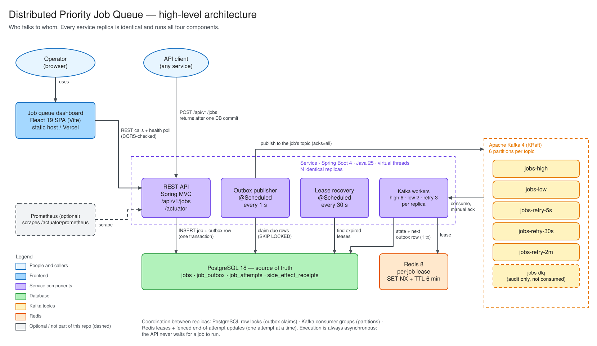
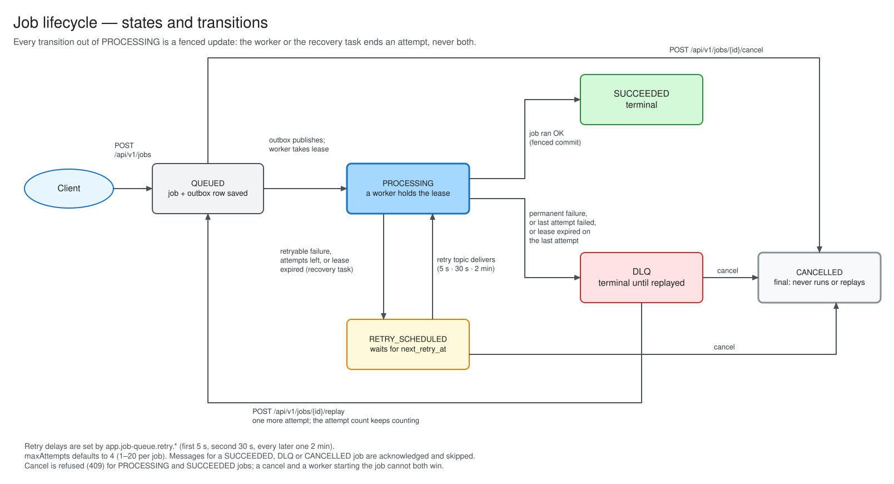

# Distributed Priority Job Queue

A Java 25 / Spring Boot 4 job queue that accepts jobs over HTTP, stores them in PostgreSQL, and runs them through Kafka priority lanes. Failed jobs move to retry lanes with backoff and then to a dead-letter queue. Duplicate job creation and duplicate business side effects are prevented even though Kafka delivers at least once.

A React dashboard for this service lives next to this repository in [`../job-queue-dashboard`](../job-queue-dashboard). It is a separate project with its own README.

## Stack

| Concern | Choice |
| --- | --- |
| Runtime | Java 25, Spring Boot 4.0.6, Spring MVC on **virtual threads** |
| Persistence | PostgreSQL 18 through `JdbcClient` + HikariCP, schema managed by Flyway |
| Transport | Apache Kafka 4 (KRaft): two priority lanes, three retry lanes, one DLQ |
| Leases | Redis 8, atomic acquire (`SET NX` with a TTL) and release (Lua compare-and-delete) |
| Observability | Actuator health probes, Micrometer counters, Prometheus endpoint |
| Build and test | Gradle 9.5.1 wrapper, JUnit 5, Testcontainers, JaCoCo |

Blocking code is used everywhere: HTTP requests, `@Scheduled` tasks, Kafka listeners and outbox publishing all run on virtual threads. Waiting on PostgreSQL, Redis or Kafka parks a virtual thread instead of holding a platform thread. The Hikari pool (`DB_POOL_SIZE`, default 32) is the real limit on database concurrency.

## Architecture



1. The API saves the job and its first outbox row in **one** PostgreSQL transaction. A job is never lost because Kafka was down when it was created.
2. The outbox publisher claims due rows with `FOR UPDATE SKIP LOCKED`, so several instances can publish without sending the same row twice. Rows left in `PUBLISHING` by a crashed instance are reclaimed after `publishing-timeout` (5 min).
3. A worker takes a Redis lease on the job, records an attempt and runs it. It then commits the new state together with the next outbox row (retry or DLQ). The Kafka offset is acknowledged only after that commit.
4. The executor writes a side-effect receipt with a unique key, so a redelivered message cannot repeat the business effect.

### Job lifecycle



Retry delays are 5 s, 30 s and then 2 min for every later attempt (`jobs-retry-5s`, `jobs-retry-30s`, `jobs-retry-2m`). Priority means more capacity, not strict ordering: `jobs-high` has 6 consumers and `jobs-low` has 2, each over 6 partitions.

### Design diagrams

| Diagram | Level | Shows |
| --- | --- | --- |
| [High-level architecture](docs/architecture/01-high-level-architecture.svg) | High | Callers, the four components of a service replica, PostgreSQL, Redis and the Kafka topics |
| [Backend components](docs/architecture/02-backend-components.svg) | Low | Spring beans and who calls whom |
| [Data model](docs/architecture/03-data-model.svg) | Low | Tables, keys, indexes and which component writes each |
| [Job lifecycle](docs/architecture/04-job-lifecycle.svg) | Low | States and transitions, including lease recovery, replay and cancel |
| [Create and publish flow](docs/architecture/05-create-and-publish-flow.svg) | Low | Create request outcomes and the transactional outbox loop |
| [Worker and recovery flow](docs/architecture/06-worker-and-recovery-flow.svg) | Low | Every decision a worker makes for one message, and the lease recovery task |
| [Dashboard architecture](../job-queue-dashboard/docs/architecture/dashboard-architecture.svg) | Low | Frontend routes, query hooks and API client (in the dashboard project) |

Each `.svg` has an editable `.excalidraw` source next to it. To change a diagram, open the `.excalidraw` file at [excalidraw.com](https://excalidraw.com) or in the VS Code Excalidraw extension, edit it, then export it as SVG over the old file (*Export image → SVG*, with *Background* on).

More detail is in [docs/ARCHITECTURE.md](docs/ARCHITECTURE.md). Operations are covered in [docs/RUNBOOK.md](docs/RUNBOOK.md).

## Local setup

### Prerequisites

| Tool | Version | Needed for |
| --- | --- | --- |
| Docker Desktop (or Docker Engine + Compose v2) | recent | PostgreSQL, Redis, Kafka, and the Testcontainers tests |
| JDK | 17 or newer to start Gradle | Gradle downloads JDK 25 through the toolchain resolver if it is not installed |
| Node.js | 20.19+ or 22.12+ | the dashboard (Vite 8) |

Ports used: `8080` (API), `5432` (PostgreSQL), `6379` (Redis), `29092` (Kafka, host listener), `5173` (dashboard).

### 1. Start the backend

Pick one of the two options.

**Option A — everything in Docker (no JDK needed):**

```bash
docker compose --profile app up -d --build
```

This starts PostgreSQL, Redis and Kafka, waits until they are healthy, then builds and starts the service as `jobqueue-app`. The first build downloads Gradle and dependencies and takes a few minutes.

**Option B — infrastructure in Docker, service on your machine (for development):**

```bash
docker compose up -d          # PostgreSQL, Redis, Kafka only
./gradlew bootRun             # Windows: .\gradlew.bat bootRun
```

Flyway creates the schema on startup and the service creates the Kafka topics itself (broker auto-creation is off).

Check that it is up:

```bash
curl http://localhost:8080/actuator/health
# {"status":"UP", ...}
```

### 2. Start the dashboard

```bash
cd ../job-queue-dashboard
cp .env.example .env.local    # points the dashboard at http://localhost:8080
npm ci
npm run dev
```

Open <http://localhost:5173>. The badge at the bottom of the sidebar (or in the mobile menu) should read **Backend up**.

The backend only accepts browser requests from origins listed in `CORS_ALLOWED_ORIGINS` (default `http://localhost:5173`). If you serve the dashboard from another port or host, add it there, for example `CORS_ALLOWED_ORIGINS=http://localhost:5173,http://localhost:4173` for `npm run preview`.

### 3. Try it end to end

With the service running, these requests exercise every path. The dashboard's **Create job** page and **API explorer** do the same from the browser.

```bash
# 1. A normal job: 201 Created, then SUCCEEDED within about a second
curl -i -X POST http://localhost:8080/api/v1/jobs -H 'Content-Type: application/json' -d '{
  "idempotencyKey": "transfer-2026-0001",
  "type": "BANK_TRANSFER_SETTLEMENT",
  "priority": "HIGH",
  "payload": {"from": "PL61109010140000071219812874", "to": "PL27109010140000071219812875", "amount": "1250.00", "currency": "PLN"},
  "maxAttempts": 4
}'

# 2. Same request again: 200 OK with the same job (idempotent)
#    Same key with a different payload: 409 IDEMPOTENCY_CONFLICT

# 3. Look it up
curl http://localhost:8080/api/v1/jobs/idempotency/transfer-2026-0001
curl http://localhost:8080/api/v1/jobs/{id}/attempts

# 4. A retryable failure: retried after 5 s and 30 s, then DLQ (3 attempts)
curl -X POST http://localhost:8080/api/v1/jobs -H 'Content-Type: application/json' -d '{
  "idempotencyKey": "retry-demo-0001", "type": "RETRYABLE_DEMO", "priority": "LOW",
  "payload": {"simulateRetryableFailure": true}, "maxAttempts": 3
}'

# 5. A permanent failure: straight to DLQ after one attempt
curl -X POST http://localhost:8080/api/v1/jobs -H 'Content-Type: application/json' -d '{
  "idempotencyKey": "permanent-demo-0001", "type": "PERMANENT_DEMO", "priority": "LOW",
  "payload": {"simulatePermanentFailure": true}
}'

# 6. Replay a DLQ job (priority is optional and defaults to LOW)
curl -X POST http://localhost:8080/api/v1/jobs/{id}/replay -H 'Content-Type: application/json' -d '{"priority":"HIGH"}'

# 7. Cancel a QUEUED, RETRY_SCHEDULED or DLQ job: final, it never runs again and cannot be replayed
curl -X POST http://localhost:8080/api/v1/jobs/{id}/cancel

# 8. Counts and list
curl http://localhost:8080/api/v1/jobs/stats
curl 'http://localhost:8080/api/v1/jobs?status=DLQ&priority=LOW&page=0&size=20'
```

A Postman collection with the same requests, plus checks on status codes, is in [`postman/distributed-job-queue.postman_collection.json`](postman/distributed-job-queue.postman_collection.json). Creating a job stores its id in the `jobId` collection variable for the requests that follow. To run it from the command line (2 s between requests, so the permanent-failure job reaches DLQ before it is replayed):

```bash
npx newman run postman/distributed-job-queue.postman_collection.json --delay-request 2000
```

### 4. Stop and reset

```bash
docker compose --profile app down      # stop, keep data
docker compose --profile app down -v   # stop and delete PostgreSQL and Redis data
```

## Testing

### Backend

The integration tests start real PostgreSQL, Kafka and Redis containers through Testcontainers, so **Docker must be running**.

```bash
./gradlew test                # Windows: .\gradlew.bat test
```

`test` also writes the coverage report. Results:

- Test report: `build/reports/tests/test/index.html`
- Coverage: `build/reports/jacoco/test/html/index.html`

| Suite | What it covers |
| --- | --- |
| `JobApiIntegrationTest` | HTTP contract: concurrent duplicate submissions create one job, 409 conflict, idempotency lookup, 404, 400 validation, list filters and paging, stats, CORS on the API and on `/actuator` |
| `JobLifecycleIntegrationTest` | Full path through outbox and Kafka: success, routing by priority, retry chain to DLQ and replay, permanent failure, replay of a non-DLQ job rejected, cancel of a DLQ job (repeatable, then no replay), cancel of a succeeded job rejected, cancel of an unknown job |
| `WorkerConcurrencyIntegrationTest` | Duplicate deliveries give one side effect, lease mutual exclusion and safe release, disjoint outbox claims, reclaim of stuck `PUBLISHING` rows, recovery of jobs stranded in `PROCESSING` (retry, DLQ on last attempt, fencing, live lease untouched), work runs on virtual threads, a cancelled job's queued message never runs it, a running job cannot be cancelled, cancel and start-of-attempt are mutually exclusive, stale messages cannot restart an ended attempt |
| `JobQueuePropertiesTest` | Startup fails when `lock-ttl` is shorter than `processing-timeout` |
| `RetryPolicyTest`, `JobPriorityTest`, `HashSupportTest`, `JobQueueMessageSerializationTest` | Unit tests |

**If Gradle cannot download its distribution on your machine** (for example a proxy or firewall that blocks the JVM but not your browser), run the build inside the official Gradle image. The image needs the Docker socket so Testcontainers can start its containers:

```bash
docker run --rm \
  -v "$PWD":/work -w /work \
  -v /var/run/docker.sock:/var/run/docker.sock \
  -v gradle-cache:/home/gradle/.gradle \
  -e TESTCONTAINERS_HOST_OVERRIDE=host.docker.internal \
  gradle:9.5.1-jdk25 gradle test --no-daemon
```

On Windows Git Bash, prefix it with `MSYS_NO_PATHCONV=1` and use `"$(pwd -W)"` for the first volume.

### Dashboard

```bash
cd ../job-queue-dashboard
npm test            # Vitest + Testing Library, no backend needed (fetch is stubbed)
npm run typecheck
npm run lint
npm run build
```

## Configuration

Every value has a local default in [`application.yml`](src/main/resources/application.yml). Override with environment variables:

| Variable | Default | Purpose |
| --- | --- | --- |
| `DB_HOST`, `DB_PORT`, `DB_NAME` | `localhost`, `5432`, `jobs` | PostgreSQL location |
| `DB_USERNAME`, `DB_PASSWORD` | `jobs`, `jobs` | PostgreSQL credentials |
| `DB_POOL_SIZE` | `32` | Hikari pool size; the bound on concurrent database work |
| `REDIS_HOST`, `REDIS_PORT` | `localhost`, `6379` | Redis location |
| `KAFKA_BOOTSTRAP_SERVERS` | `localhost:29092` | Kafka brokers |
| `CORS_ALLOWED_ORIGINS` | `http://localhost:5173` | Comma-separated browser origins allowed to call the API and `/actuator` |

Queue tuning (topic names, consumer counts, retry delays, outbox batch size, lease TTL, stranded-job recovery interval) is under `app.job-queue.*` and can be set with Spring's usual relaxed binding, for example `APP_JOBQUEUE_WORKER_HIGHCONCURRENCY=12`. Startup fails if `worker.lock-ttl` is shorter than `worker.processing-timeout`.

## API

Base path `/api/v1/jobs`. Errors are returned as `{"code", "message", "timestamp"}`.

| Method | Path | Result |
| --- | --- | --- |
| `POST` | `/api/v1/jobs` | `201` new job (with `Location`), `200` same key and same request, `409 IDEMPOTENCY_CONFLICT` same key and different request, `400` invalid body |
| `GET` | `/api/v1/jobs` | Page of jobs, newest first. Filters: `status`, `priority`, `type` (case-insensitive), `createdFrom`, `createdTo` (ISO-8601), `page` (from 0), `size` (1–100, default 20) |
| `GET` | `/api/v1/jobs/{id}` | Job, including `payloadJson` and `resultJson`; `404 JOB_NOT_FOUND` if unknown |
| `GET` | `/api/v1/jobs/{id}/attempts` | Attempt history, oldest first |
| `GET` | `/api/v1/jobs/idempotency/{key}` | Job by idempotency key; `404` if unknown |
| `POST` | `/api/v1/jobs/{id}/replay` | Moves a `DLQ` job back to `QUEUED`. Body `{"priority": "HIGH"}`, or `{}` for `LOW`; `409 INVALID_JOB_STATE` if the job is not in DLQ |
| `POST` | `/api/v1/jobs/{id}/cancel` | Cancels a `QUEUED`, `RETRY_SCHEDULED` or `DLQ` job; no body. `200` with the job, also when it was already `CANCELLED`; `409 INVALID_JOB_STATE` when it is `PROCESSING` or `SUCCEEDED`; `404` if unknown. A cancelled job never runs again and cannot be replayed |
| `GET` | `/api/v1/jobs/stats` | Counts by status, counts by priority and status, mean duration of successful attempts |
| `GET` | `/actuator/health`, `/actuator/health/{liveness,readiness}` | Health probes |
| `GET` | `/actuator/prometheus` | Metrics |

Job fields: `idempotencyKey` (≤ 200 chars), `type` (≤ 100 chars, stored upper case), `priority` (`HIGH` or `LOW`), `payload` (any JSON value), `maxAttempts` (1–20, default 4). The demo executor fails on purpose when the payload contains `"simulateRetryableFailure": true` or `"simulatePermanentFailure": true`.

## Topics

| Purpose | Topic | Consumers |
| --- | --- | --- |
| High-priority lane | `jobs-high` | 6 |
| Low-priority lane | `jobs-low` | 2 |
| First retry, after 5 s | `jobs-retry-5s` | 3 shared by the three retry topics |
| Second retry, after 30 s | `jobs-retry-30s` | |
| Third and later retries, after 2 min | `jobs-retry-2m` | |
| Dead letter (audit; not consumed) | `jobs-dlq` | — |

## Correctness model

Kafka delivers **at least once**, not exactly once to the database or the outside world. This service prevents duplicate business effects with application-level controls:

1. **Unique idempotency key** on `jobs`: a repeated create request returns the existing job.
2. **Request hash**: the same key with a different type, priority or payload returns `409`.
3. **Transactional outbox**: job state and the intent to publish are committed together.
4. **Manual Kafka acknowledgement**: an offset is acknowledged only after the next state has been committed, or after a safe skip.
5. **Redis lease**: stops two instances from running the same job at the same time. It is released with a compare-and-delete script, so a worker can never release another worker's lease.
6. **Side-effect receipt**: `side_effect_receipts.effect_key` is unique, so a redelivered message cannot create the same effect twice.
7. **Terminal-state check**: a message for a job that is already `SUCCEEDED`, `DLQ` or `CANCELLED` is acknowledged and skipped.
8. **Stranded-job recovery**: a scheduled task (every 30 s) retries jobs still `PROCESSING` after their worker's lease expired, for example because the worker crashed. Ending an attempt is fenced on its attempt number, so a slow worker that comes back cannot overwrite the job.

## Production notes

- Use topic replication factor 3 and `min.insync.replicas=2`.
- Use TLS/SASL for Kafka, and TLS, passwords and ACLs for Redis and PostgreSQL.
- Add retention for `job_attempts`, sent `job_outbox` rows and the DLQ topic.
- Keep side-effect receipts for as long as the business needs its idempotency window.
- Run high-priority workers as their own deployment when they need separate autoscaling.
- Alert on `jobqueue_worker_dlq_total` and `jobqueue_outbox_publish_failed_total` (see the runbook).

## Repository layout

```text
src/main/java/com/github/pants/jobqueue/
  api/          REST controller, request/response records, error mapping
  config/       typed properties, Kafka, CORS, clock
  domain/       statuses, priorities, messages
  messaging/    Kafka listeners and outbox publisher
  persistence/  JobStore (JdbcClient) and row records
  service/      create/replay/cancel commands, worker, retry policy, Redis lock, executor, lease recovery
src/main/resources/db/migration/   Flyway schema
docs/                              architecture notes and runbook
docs/architecture/                 design diagrams (.excalidraw sources + exported .svg)
postman/                           Postman collection
```
