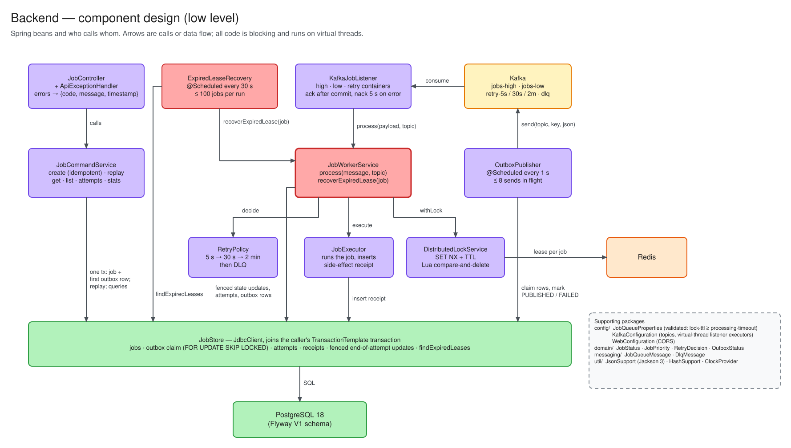
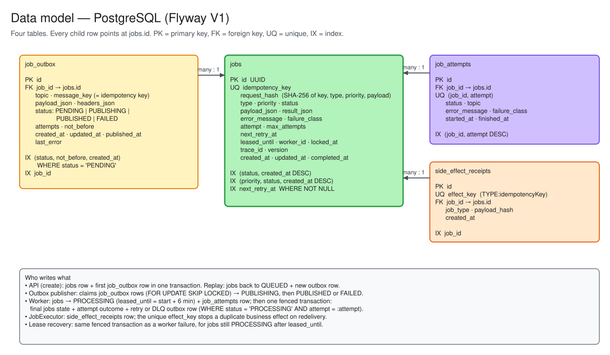
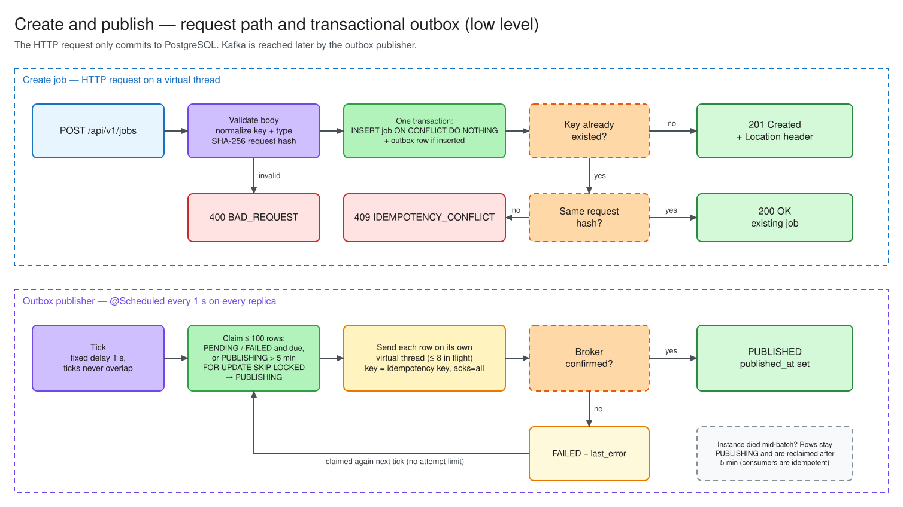
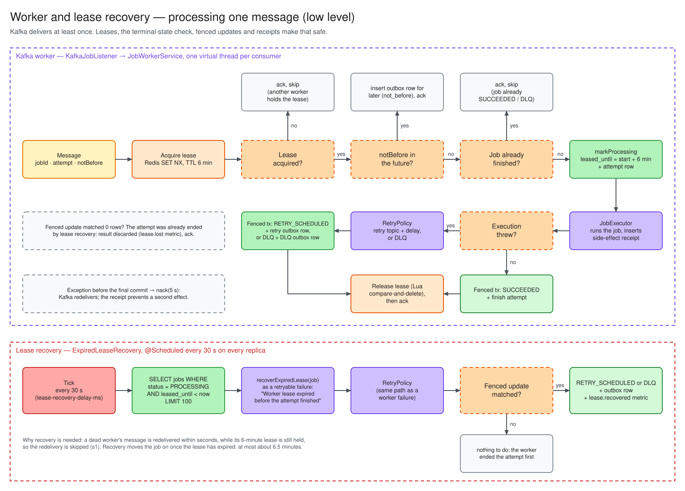

# Architecture

The diagrams below are exported from the `.excalidraw` sources in [`architecture/`](architecture/); edit those and re-export to SVG to change them. The high-level view is in the [README](../README.md#architecture).

## Components

Each replica runs the API, the outbox publisher, the lease recovery task and the workers. Nothing is coordinated in memory between replicas: PostgreSQL row locks coordinate the outbox, Kafka consumer groups split partitions, and Redis leases stop the same job from running twice at once.

## Threading model

The service is written as plain blocking code and runs it on virtual threads:

| Work | Where it runs |
| --- | --- |
| HTTP requests | Tomcat, virtual thread per request (`spring.threads.virtual.enabled`) |
| `@Scheduled` outbox tick | virtual thread; a fixed-delay schedule never overlaps ticks |
| Publishing one outbox row | its own virtual thread; a `Semaphore` caps rows in flight at `outbox.publish-concurrency` (8) |
| Kafka listener containers | consumer threads from a virtual-thread executor; one per configured consumer |

Virtual threads make waiting cheap, so the bounds are explicit resources rather than thread pools: the Hikari pool (`DB_POOL_SIZE`, 32), the publish semaphore, listener concurrency, and a 30 s JDBC query timeout so a stuck statement cannot hold a worker forever. Redis uses one shared Lettuce connection that multiplexes commands from all threads.

## Data model

| Table | Purpose | Key constraint |
| --- | --- | --- |
| `jobs` | Current state of each job | unique `idempotency_key` |
| `job_outbox` | Kafka messages waiting to be published, with `not_before` for delayed retries | claimed with `FOR UPDATE SKIP LOCKED` |
| `job_attempts` | One audit row per processing attempt: topic, timing, outcome, error | `(job_id, attempt)` |
| `side_effect_receipts` | Proof that a business effect happened | unique `effect_key` |

The schema is in `src/main/resources/db/migration/V1__init_schema.sql`.

## Create path and outbox publishing

The request hash is a SHA-256 of a record holding key, type, priority and payload. A record serializes its fields in declaration order, so every JVM produces the same hash for the same request. Concurrent submissions of the same key resolve to one row through the unique constraint.

### Outbox publishing

Every second the publisher claims up to `outbox.batch-size` (100) due rows, marking them `PUBLISHING` in the same statement that locks them with `FOR UPDATE SKIP LOCKED`. Other replicas skip locked rows, so claims are disjoint. Each row is sent to Kafka keyed by idempotency key and marked `PUBLISHED` once the broker confirms. If the send fails the row is marked `FAILED` with the error, and the next tick claims it again; there is no attempt limit, so rows wait out a Kafka outage instead of being dropped.

If an instance dies after claiming rows, those rows stay `PUBLISHING`. A later tick reclaims any row that has been `PUBLISHING` longer than `outbox.publishing-timeout` (5 min). Reclaiming can publish a row twice; that is safe because the consumer side is idempotent.

## Processing path

If anything throws before the final commit, the message is not acknowledged and Kafka redelivers it. The redelivered run hits the same receipt key, so the business effect is not repeated.

### Stranded jobs

If the worker process dies, the redelivered message arrives while the dead worker's lease is still in Redis, so it is skipped and acknowledged. `ExpiredLeaseRecovery`, a scheduled task on every replica (every 30 s), finds jobs still `PROCESSING` after `leased_until` and ends the attempt as a retryable failure through the same code path a worker uses.

The final update of an attempt (`SUCCEEDED`, `RETRY_SCHEDULED` or `DLQ`) is fenced with `WHERE status = 'PROCESSING' AND attempt = :attempt`. Only one party, the worker or the recovery task, can end a given attempt, and the retry or DLQ outbox row is written only by that party. The Redis lock expires no later than `leased_until`, so the retry's worker can take the lease.

## Retry design

Workers never sleep on a hot topic. A failed job is stored as `RETRY_SCHEDULED` and a retry outbox row is inserted with `not_before = now + delay`. The publisher only sends due rows, so the retry topic receives the message when it is ready to run.

| Failed attempt | Next topic | Delay |
| --- | --- | --- |
| 1 | `jobs-retry-5s` | 5 s |
| 2 | `jobs-retry-30s` | 30 s |
| 3 and later | `jobs-retry-2m` | 2 min |

A `NonRetryableJobException`, or a failure on the last allowed attempt, moves the job to `DLQ` and publishes a `DlqMessage` to `jobs-dlq` for audit. Nothing consumes `jobs-dlq`; replay works from the database.

## Why not rely on Kafka exactly-once semantics?

Kafka transactions cover Kafka-to-Kafka flows. Business effects touch databases, payment providers, email, ledgers and external APIs, which are outside a Kafka transaction. The service therefore treats delivery as at-least-once and makes the effect idempotent.

## Duplicate prevention layers

1. Unique `jobs.idempotency_key` prevents duplicate job creation.
2. `request_hash` detects a key reused for a different request.
3. Redis leases stop concurrent processing of one job. Lease TTL (6 min) must be at least `processing-timeout` (5 min); startup fails otherwise.
4. Leases are released with a Lua script that deletes only if the stored token is still ours, so a worker whose lease expired cannot delete the next owner's lease.
5. Unique `side_effect_receipts.effect_key` (`TYPE:idempotencyKey`) stops a duplicate effect even if two workers ever run the same job.
6. Terminal states are checked before execution, so redelivery after success is a no-op.
7. Ending an attempt is fenced on its attempt number, so a worker whose stranded attempt was recovered cannot overwrite the job.
